# Sports Knowledge Graph with RAG

A working implementation of a sports fan knowledge graph combined with vector search and retrieval-augmented generation (RAG). The system answers natural language questions about fans, teams, venues, and events by pulling facts from both a graph database and a semantic document index — then passing everything to a language model as grounded context.

---

## Project Files

| File | What it does |
|---|---|
| `knowledge_graph.py` | Builds the knowledge graph, defines entity types and relationships, runs multi-hop traversal queries, generates the graph visualization |
| `rag_knowledge_graph.py` | Extends the graph with vector embeddings (sentence-transformers + FAISS), hybrid retrieval, context assembly, and a pluggable LLM interface |

---

## Core Concepts

### 1. Ontology — A Common Language for Your Data

An ontology is an agreed-upon vocabulary for what kinds of things exist in your domain and how they relate to each other. Without one, "Sarah" in the ticketing system, "S. Johnson" in the CRM, and `user_8821` in the mobile app are three separate records with no visible connection. Define an ontology, resolve those identities, and they collapse into one `Fan` node that carries all their relationships.

The diagram below shows a simple example of what a sports knowledge graph ontology looks like:

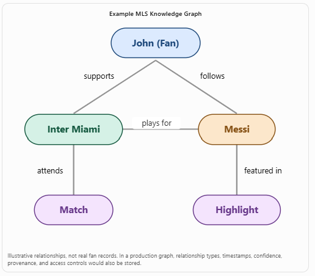

In `knowledge_graph.py`, the ontology is the `type` attribute on every node — `Fan`, `Team`, `City`, `Venue`, `Event` — and the `rel` attribute on every edge — `FOLLOWS`, `LIVES_IN`, `PLAYS_AT`, `ATTENDS`, `HOSTED_AT`. In the context of using graphs to establish domain relationships, that is all an ontology is: a schema enforced at the graph level rather than inside relational tables. The code comment block at the top of `knowledge_graph.py` (see the code in the repo) maps each concept directly to what it means in the code:

```python
# Entities (nodes)     Fans, teams, cities, venues, events
# Relationships (edges) FOLLOWS, LIVES_IN, PLAYS_AT, ATTENDS
# Ontology / schema    The type attribute on every node
```

---

### 2. Entities and Nodes

Each real-world thing becomes a node in the graph. The project has five entity types, thirteen nodes total, and each carries typed attributes:

```python
fans = {
    "sarah":  {"type": "Fan", "name": "Sarah"},
    "mike":   {"type": "Fan", "name": "Mike"},
    "priya":  {"type": "Fan", "name": "Priya"},
}
teams = {
    "lafc":      {"type": "Team", "name": "LAFC"},
    "lagalaxy":  {"type": "Team", "name": "LA Galaxy"},
    "sounders":  {"type": "Team", "name": "Seattle Sounders"},
}
# ... cities, venues, events
```

The visualization below is generated automatically when you run `knowledge_graph.py`. Node colors encode entity type:
- **Blue** = Fan, **Red** = Team, **Green** = City, **Yellow** = Venue, **Purple** = Event

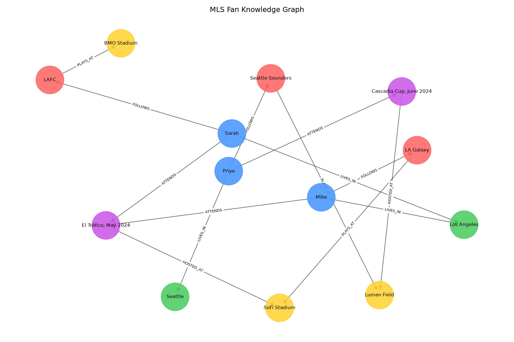

The graph makes the structure immediately readable. You can see at a glance that Sarah and Mike both live in Los Angeles, that LAFC plays at BMO Stadium while LA Galaxy plays at SoFi, and that El Tráfico was attended by two fans. Relationships are directional — the arrow on each edge tells you who the subject is.

---

### 3. Relationships (Edges) and Graph Traversal

Edges are what make a knowledge graph genuinely different from a set of tables. The relationship chain `Sarah → FOLLOWS → LAFC → PLAYS_AT → BMO Stadium` is a path through the graph. You can traverse it without knowing in advance what you are looking for. In SQL that would be at least two JOINs; in a graph it is a path pattern.

The `neighbors_by_relation()` function in `knowledge_graph.py` is the basic traversal primitive. The more interesting function is `fans_in_city_who_follow_teams_playing_at()`, which chains three hops:

```
City <-[LIVES_IN]- Fan -[FOLLOWS]-> Team -[PLAYS_AT]-> Venue
```

The terminal output below shows all four traversal queries running:

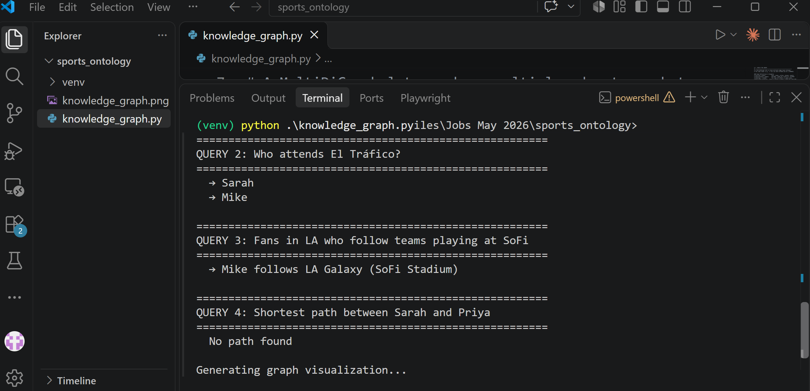

Query 3 — "Fans in LA who follow teams playing at SoFi" — returns Mike because his path through the graph connects Los Angeles → Mike → LA Galaxy → SoFi Stadium. The shortest-path query (Query 4) converts the directed graph to undirected and uses NetworkX's built-in BFS to find the connection between any two nodes.

The comment block at the bottom of `knowledge_graph.py` maps each code pattern to its production equivalent:

| This project | Production equivalent |
|---|---|
| `networkx.MultiDiGraph` | Neo4j, Amazon Neptune, TigerGraph |
| `neighbors_by_relation()` | Cypher: `MATCH (f:Fan)-[:LIVES_IN]->(c:City)...` |
| Hardcoded nodes | Entity resolution pipelines merging records across ticketing, CRM, app |
| 5 node types | Dozens: Fan, Segment, Campaign, Seat, Match, Sponsor, … |
| Manual edge creation | Streaming enrichment from real-time event data |

---

### 4. Vector Embeddings and Semantic Search

Not everything important about a fan fits in a graph edge. Account notes, pricing policies, and unstructured text live outside the graph structure. Vector embeddings handle this: they convert text into a list of numbers — a vector — where sentences with similar meaning end up close together in that number space.

In `rag_knowledge_graph.py`, every graph node gets converted to a plain-English fact sentence:

```python
def describe_node(node_id):
    # "Sarah is a Fan. Sarah lives in Los Angeles. Sarah follows LAFC."
    attrs = G.nodes[node_id]
    facts = []
    for _, target, data in G.out_edges(node_id, data=True):
        target_name = G.nodes[target]["name"]
        rel = data["rel"]
        facts.append(f"{attrs['name']} {rel.lower().replace('_', ' ')} {target_name}.")
    return f"{attrs['name']} is a {attrs['type']}. " + " ".join(facts)
```

These fact sentences, plus unstructured documents like account notes and pricing policies, all get embedded with `sentence-transformers/all-MiniLM-L6-v2` and stored in a FAISS index. When a question arrives, its embedding is compared against every document in the index using cosine similarity, and the top-k closest matches come back as context.

The output below shows the RAG pipeline handling the question *"What team does Sarah follow and where does she live?"* — you can see the full prompt being assembled with the retrieved graph facts:

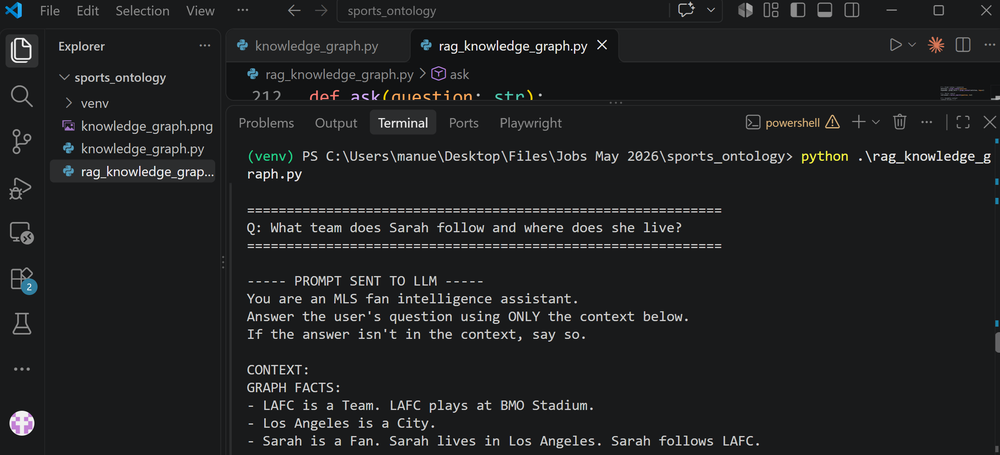

After retrieval, the pipeline prints which graph entities were expanded and the top documents with their similarity scores:

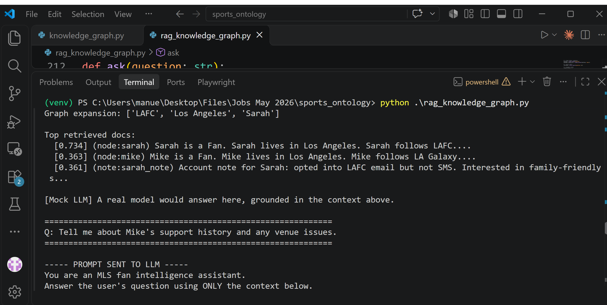

The three retrieved documents score 0.734, 0.363, and 0.361 respectively. The top result (`node:sarah`) scores highest because Sarah's fact sentence is the closest match to the question — which is exactly the behavior you want from a semantic search system.

---

### 5. The RAG Pipeline — Putting It All Together

RAG (Retrieval-Augmented Generation) is a pattern for giving a language model your own data at question time, so it can answer based on facts you control rather than only on what it learned during training. The pipeline in `rag_knowledge_graph.py` follows four steps:

```
User question
      │
      ▼
1. Graph lookup    → find entities named in the question, expand 1 hop
      │
      ▼
2. Vector search   → find top-k semantically similar documents
      │
      ▼
3. Context assembly → combine graph facts + retrieved text into one prompt
      │
      ▼
4. LLM generation  → grounded answer with traceable sources
```

The architecture diagram below shows how these components fit into a broader semantic data platform:

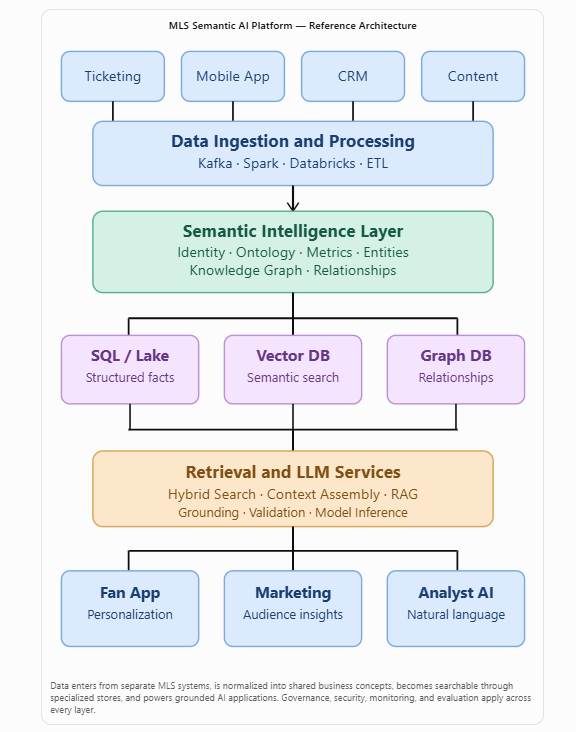

Data enters from multiple source systems (ticketing, mobile app, CRM, content). A semantic intelligence layer — the ontology, knowledge graph, and entity models — normalizes it into shared concepts. Those normalized representations feed three storage types: a SQL/Lake store for structured facts, a vector database for semantic search, and a graph database for relationship traversal. The retrieval and LLM services pull from all three and deliver grounded outputs to downstream applications.

---

### 6. Worked Example: Unstructured Data + Graph Facts

**Question:** *"Tell me about Mike's support history and any venue issues."*

The graph has no `SUPPORT_HISTORY` edge — that information only exists in an unstructured account note. Here is what each step produces:

**Step 1 — Graph lookup:** The entity linker finds "Mike" in the question. The 1-hop expansion pulls in his connected nodes: Los Angeles and LA Galaxy.

**Step 2 — Vector search:** FAISS returns the account note (`note:mike_note`), Mike's fact sentence (`node:mike`), and the BMO Stadium node (`node:bmo`).

The prompt being assembled for this question:

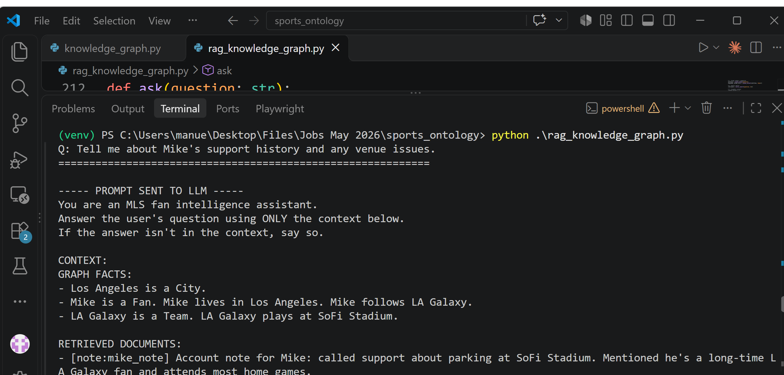

The retrieved documents and graph expansion results:

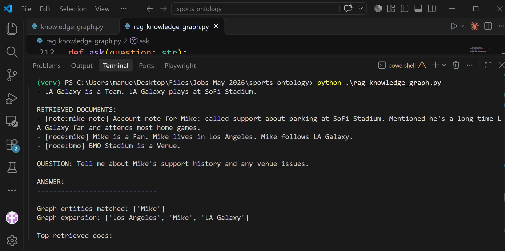

The account note surfaces because the phrase "support history" and "venue issues" in the question is semantically close to "called support about parking at SoFi Stadium" in the note. The vector index found it even though there is no keyword overlap — that is semantic search working as intended.

**Step 3 — Context assembly:** Graph facts and retrieved documents are formatted into a single prompt block:

```
GRAPH FACTS:
- Los Angeles is a City.
- Mike is a Fan. Mike lives in Los Angeles. Mike follows LA Galaxy.
- LA Galaxy is a Team. LA Galaxy plays at SoFi Stadium.

RETRIEVED DOCUMENTS:
- [note:mike_note] Account note for Mike: called support about parking at SoFi Stadium...
- [node:mike] Mike is a Fan. Mike lives in Los Angeles. Mike follows LA Galaxy.
- [node:bmo] BMO Stadium is a Venue.
```

**Step 4 — Generation:** The LLM answers using only the assembled context. Every fact in the answer is traceable back to a specific source.

---

### 7. Worked Example: Cross-Source Reasoning

**Question:** *"What perks does Sarah get as a season member at BMO Stadium?"*

This question is interesting because the graph has no "perks" relationship. The information lives in a policy document added to the vector corpus:

```python
("policy", "member_perks",
 "Season members get 15% off concessions at BMO Stadium and priority access to playoff tickets."),
```

The graph lookup finds Sarah and expands to LAFC and Los Angeles. The vector search surfaces the `member_perks` policy document alongside Sarah's fact sentence. Together they give the LLM everything it needs: the Sarah → LAFC → BMO Stadium path from the graph confirms she is connected to that venue, and the policy document provides the perk details.

The prompt being assembled:

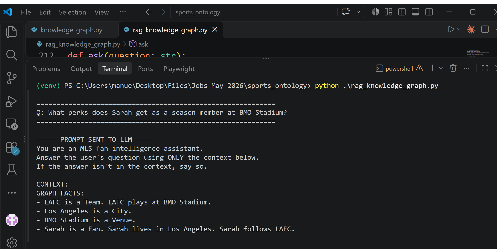

The retrieved documents for this question:

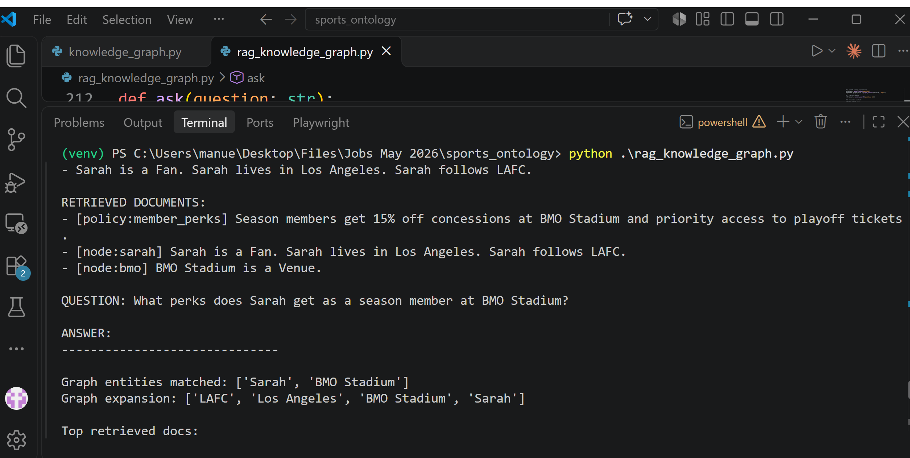

This is the core value of hybrid retrieval: neither the graph alone nor the vector index alone could answer this question, but together they can.

---

### 8. Worked Example: Multi-Fan Query

**Question:** *"Which fans follow teams in Seattle?"*

This one routes primarily through the graph. "Seattle" matches the city node; 1-hop expansion pulls in the Seattle Sounders; a second hop pulls in Priya. The vector index contributes supporting context.

Graph traversal prompt:

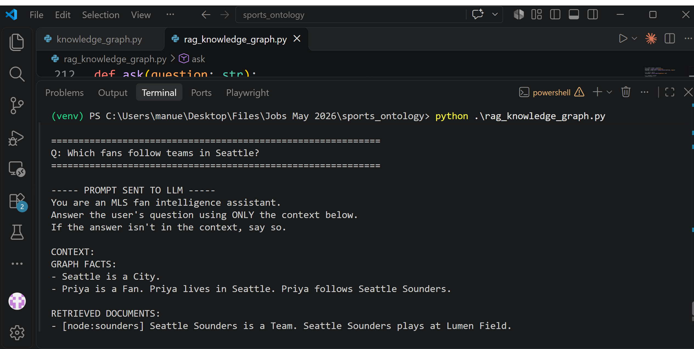

Retrieved context and final output:


---

### 9. Traceability and Explainability

Every call to `ask()` prints a full audit trail:

```
Graph entities matched: ['Sarah']
Graph expansion: ['LAFC', 'Los Angeles', 'Sarah']

Top retrieved docs:
  [0.734] (node:sarah) Sarah is a Fan. Sarah lives in Los Angeles. Sarah follows LAFC...
  [0.363] (node:mike) Mike is a Fan. Mike lives in Los Angeles. Mike follows LA Galaxy...
  [0.361] (note:sarah_note) Account note for Sarah: opted into LAFC email but not SMS...
```

You can trace every claim in the generated answer back to a specific source — a graph node or a retrieved document with its similarity score. This matters when you need to explain why the system returned a particular result or catch cases where retrieved context was misleading.

---

## Installation

```bash
pip install networkx matplotlib numpy faiss-cpu sentence-transformers
```

## Running

```bash
# Build the knowledge graph, run traversal queries, save graph visualization
python knowledge_graph.py

# Run the full RAG pipeline with four demo questions
python rag_knowledge_graph.py
```

`knowledge_graph.py` saves `knowledge_graph.png` to the current directory. `rag_knowledge_graph.py` uses a mock LLM by default so it runs offline with no API key. To swap in a real model, replace the `mock_llm()` function body — the code includes commented-out examples for both the OpenAI SDK and a local open-weight model via llama-cpp-python.

## Swapping in a Real LLM

The `mock_llm()` function in `rag_knowledge_graph.py` is a drop-in placeholder. Replace its body to connect any model:

```python
# OpenAI
from openai import OpenAI
client = OpenAI()
return client.chat.completions.create(
    model="gpt-4o-mini",
    messages=[{"role": "user", "content": prompt}],
).choices[0].message.content

# Local open-weight model (on-prem, no API key)
# llama_cpp, vllm, or ollama work the same way
```

The rest of the pipeline — graph lookup, vector search, context assembly — stays exactly the same regardless of which model you use.


---


### Thank you for reading

#### Please consider giving a star if you find the repo useful. Thank you.

---

### **AUTHOR'S BACKGROUND**
### Author's Name:  Emmanuel Oyekanlu
```
Skillset:   I have experience spanning several years in data science, enterprise AI architecture and solutions, developing scalable enterprise data pipelines,
enterprise solution architecture, architecting enterprise systems data and AI applications,
software and AI solution design and deployments, data engineering, industrial intelligent vision systems, high performance computing (GPU, CUDA), machine learning,
NLP, Agentic-AI and LLM applications as well as deploying scalable solutions (apps) on-prem and in the cloud.

I can be reached through: manuelbomi@yahoo.com

website: https://www.emmanueloyekanlu.com/
Publications:  https://scholar.google.com/citations?user=S-jTMfkAAAAJ&hl=en
LinkedIn:  https://www.linkedin.com/in/emmanuel-oyekanlu-6ba98616
Github:  https://github.com/manuelbomi

```
[](https://skillicons.dev)

